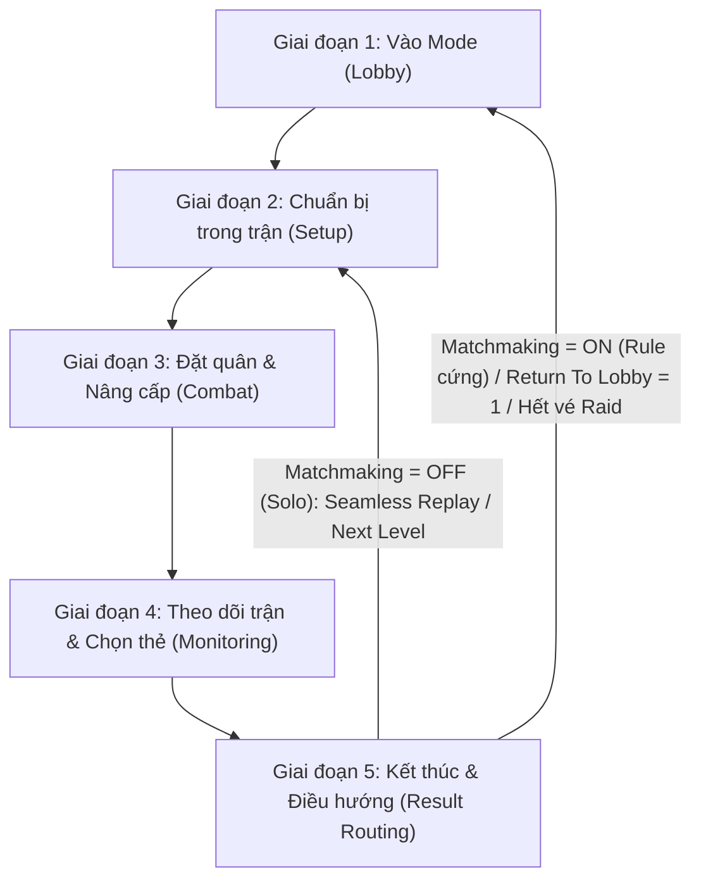

# AGENTS.md — Anime Adventures AutoHotkey Macro (KuruMacro / Mango)

Tài liệu hướng dẫn tổng quan dự án, bản đồ kiến trúc hệ thống và vòng đời hoạt động dành cho AI Agent.

---

## 1. Giới thiệu dự án (Project Overview)

- **Tên dự án**: Anime Adventures Mango Macro (AHK v2.0).
- **Mục tiêu**: Tự động hóa hoàn toàn chu trình chơi tựa game **Anime Adventures trên Roblox** mà không cần người dùng can thiệp (chạy liên tục, cắm máy nhiều giờ/ngày).

- **Các tác vụ macro thực hiện**:
  1. Tự động di chuyển trong sảnh (Lobby) đến từng chế độ được chọn.
  2. Tự động chọn chế độ, chọn map muốn chơi, xử lý vào phòng Solo (`Play Here`) hoặc Ghép đội (`Find Match`).
  3. **Tự động nhận diện và nhập Captcha số** khi tham gia chế độ ghép đội.
  4. Căn góc camera nhìn từ trên xuống, di chuyển nhân vật đến vị trí đặt quân chiến thuật trên từng map.
  5. Đặt quân (Unit Placement) theo tọa độ đã lưu hoặc thuật toán quét đường tròn 64 điểm.
  6. Tự động kiểm tra trạng thái và nâng cấp quân (Upgrade Units) theo thứ tự ưu tiên và giới hạn cấp độ.
  7. Tự động phát hiện và kích hoạt kỹ năng nhân vật (Auto Ability).
  8. Xử lý màn hình chọn thẻ bài / buff (Event Card Picker) bằng OCR và thuật toán blueprint.
  9. Nhận diện kết thúc trận (Victory / Defeat), gửi thông báo Discord Webhook và điều hướng Replay hoặc Return to Lobby để lặp lại chu trình.

---

## 2. Công nghệ cốt lõi (Technology Stack)

- **Ngôn ngữ**: [AutoHotkey v2](https://www.autohotkey.com/v2/) (Trình thông dịch 64-bit tại `C:\Users\thoan\AppData\Local\Programs\AutoHotkey\v2\AutoHotkey64.exe`).
- **Xử lý đồ họa & Nhận diện**:
  - `FindText`: Thư viện nhận diện mẫu pixel / hình ảnh / chữ nhị phân cực nhanh không cần lưu file ảnh rời.
  - `Windows.Media.Ocr` (`OCR-main`): Tích hợp Windows OCR engine để đọc văn bản động (tên map, số Captcha, nội dung thẻ bài, cấp độ nâng cấp).
  - `GDI+` (`AHKv2-Gdip-master`): Chụp màn hình client Roblox trực tiếp từ bộ nhớ phục vụ xử lý ảnh.
- **Tương tác Input đặc thù Roblox**:
  - Roblox DirectInput bỏ qua các lệnh `MouseClick` / `SendInput` thông thường. Macro sử dụng cơ chế `SendMode "Event"` kết hợp helper `FixClick` (di chuyển $\rightarrow$ rung nhẹ 1px $\rightarrow$ click) và `FixMove` (di chuyển $\rightarrow$ rung 1px trước khi cuộn chuột) để đảm bảo game không nuốt thao tác.
- **Tích hợp mở rộng**: Discord Webhook để gửi báo cáo thắng/thua, thời gian hoàn thành màn chơi kèm ảnh chụp.

---

## 3. Kiến trúc thư mục & Bản đồ Module (Project Architecture)

Dự án được phân cấp thành 2 phân vùng:

### 🔴 Phân vùng PROD (`D:\Macro\AA mango`) — Hệ thống chính thức
Đây là mã nguồn đang vận hành thực tế của người dùng:

| File / Thư mục | Vai trò và chức năng chính |
|---|---|
| `Main.ahk` | Entrypoint của macro. Khởi tạo môi trường, nạp cấu hình, hook hotkey và chứa **Dev Harness Hook (`--run <FunctionName>`)** cho phép chạy kiểm thử độc lập một hàm bất kỳ. |
| `Lib\GameMango.ahk` | **Trái tim logic của macro** (~7000 dòng):<br>- Điều hướng vào từng chế độ game (`StoryMode`, `Infinite`, `RaidMode`, `LegendMode`, `InfinityCastleMode`, `DungeonMode`, `SummerEventMode`, v.v.).<br>- Logic đầu trận: căn camera (`PlacementCamera`), di chuyển theo từng map (`MoveFor<Map>`), bật vote wave (`StartedGame`).<br>- Logic đặt quân (`PlacingUnits`, `PlaceUnit`, `GenerateCirclePoints`).<br>- Logic nâng cấp (`UpgradeUnits`, `UpgradeUnit`, `MaxUpgrade`).<br>- Logic theo dõi trận & thẻ bài (`MonitorStage`, `WaitForCardChoice`, `ChooseCard`).<br>- Logic nhận diện kết thúc (`MonitorEndScreen`, `ResultScreenReady`, `ChooseResultRoute`). |
| `Lib\Functions.ahk` | **Tầng tiện ích & dịch vụ hệ thống**:<br>- Quản lý cấu hình (`readInSettings`, `SaveSettings`).<br>- Input helpers (`FixClick`, `FixMove`).<br>- Xử lý Captcha (`CaptchaDetect`).<br>- Xử lý toggle cài đặt Roblox (`TpSpawn`, `FindUpgradeToggleRow`).<br>- Quản lý chat và leaderboard (`CloseChat`, `ClosePlayerLeaderBoard`). |
| `Lib\GUI.ahk` | Giao diện đồ họa macro (AHK GUI): danh sách chọn chế độ, map, act, checkbox tính năng (`Matchmaking`, `Next Level`, `Return To Lobby`, `Auto Ability`), cấu hình slot 1-6 và hotkeys điều khiển. |
| `Lib\Image.ahk` | Chứa toàn bộ chuỗi mã hóa ký tự và hình ảnh dùng cho `FindText` (nút bấm, chữ Victory, Defeat, thanh máu, biểu tượng chế độ). |
| `Lib\webhooksettings.ahk` | Cấu hình và gửi webhook Discord. |
| `Settings\Configuration.txt` | Lưu trạng thái cấu hình hiện tại của người dùng (Mode, Map, Enabled slots, Placement, Matchmaking, MaxLevel). |

### 🟢 Phân vùng DEV (`D:\Macro\AA-mango-dev`) — Vùng thí nghiệm & Kiểm thử của Agent
- Thư mục sandbox cho Agent thực hiện nghiên cứu, lập test script, chạy probe đo đạc tọa độ, kiểm tra OCR.
- Agent có thể `#Include` trực tiếp thư viện từ PROD để kiểm thử mà không làm thay đổi file gốc.

---

## 4. Vòng đời hoạt động của Macro (Macro Execution Lifecycle)

Một vòng lặp tự động hoàn chỉnh diễn ra theo 5 giai đoạn:



### Chi tiết từng giai đoạn:
1. **Giai đoạn 1: Vào Mode từ Lobby (`StartSelectedMode`)**:
   - Nhân vật thực hiện lộ trình đi bộ (`<Mode>Movement`) đến khu vực chọn màn.
   - Khi bảng chọn mở ra (`IsModeCancelOpen`), macro kiểm tra checkbox `Matchmaking`:
     - Nếu **có tick**: Gọi `FindMatch()`, tự phát hiện bảng số Captcha, giải bằng `CaptchaDetect`, gõ số và bấm xác nhận để tìm phòng.
     - Nếu **không tick**: Bấm `PlayHere()` để vào trận một mình (Solo).
2. **Giai đoạn 2: Thiết lập đầu trận (`RestartStage` $\rightarrow$ `BasicSetup`)**:
   - Chờ game load (`CheckLoaded`), tự động phát hiện nếu bị trả về sảnh (do hết vé Raid/key) để xử lý an toàn.
   - Tắt Leaderboard, tắt Chat (`CloseChat`).
   - Teleport về Spawn (`TpSpawn`), chỉnh góc nhìn camera phẳng (`PlacementCamera`).
   - Đi bộ đến vị trí đường quái (`HandleMapMovement` theo từng Map).
   - Tự động bỏ phiếu bắt đầu màn chơi (`StartedGame`).
3. **Giai đoạn 3: Đặt quân & Nâng cấp (`PlacingUnits`)**:
   - Chọn slot unit bằng phím số `1`–`6`.
   - Quét tọa độ đặt quân (theo file cấu hình hoặc thuật toán hình tròn 64 điểm `GenerateCirclePoints`).
   - Xác nhận đặt quân thành công qua thanh máu/panel (`UnitPlaced`).
   - Mở panel unit và nâng cấp (`UpgradeUnits`) theo cấp độ mong muốn (`MaxLevel1-6`).
4. **Giai đoạn 4: Theo dõi trận & Sự kiện (`MonitorStage`)**:
   - Kiểm tra Anti-AFK định kỳ mỗi 5 phút.
   - Quét màn hình chọn thẻ bài sự kiện (`WaitForCardChoice` / `ChooseCard`), tự động đọc buff bằng OCR và click chọn thẻ tối ưu.
   - Tự động dùng kỹ năng nhân vật (`AutoAbilityBox`).
5. **Giai đoạn 5: Kết thúc trận & Tái khởi động (`MonitorEndScreen`)**:
   - Phát hiện màn hình XP / Thắng / Thua (`VictoryText` / `DefeatText`).
   - Gửi Discord Webhook kèm thời gian hoàn thành.
   - Bấm `Next` qua màn hình tổng kết (`summary`).
   - **Quy tắc điều hướng cuối trận**:
     - **Matchmaking = ON (Rule cứng)**: Bắt buộc bấm **Return to lobby** $\rightarrow$ Quay lại Giai đoạn 1 để giải tán phòng và ghép trận mới từ sảnh.
     - **Matchmaking = OFF (Chơi Solo)**: Tận dụng cơ chế **Seamless Replay (BETA)** tái khởi động tại chỗ sau loading screen ngắn:
       - Nếu tick **Return To Lobby** (`ReturnLobbyBox = 1`): Bấm `Return to lobby` $\rightarrow$ Quay lại Giai đoạn 1 để về sảnh.
       - Nếu Story và tick **Next Level** (`NextLevelBox = 1`): Bấm `Next Level` (hoặc `Next Room`) $\rightarrow$ Khởi động in-place sang Act tiếp theo.
       - Mặc định: Bấm **Replay** (hoặc `Retry` trong Infinity Mansion) $\rightarrow$ Tái khởi động ngay tại chỗ (Giai đoạn 2) mà không đổi server.
     - **Summer Hunt**: Khi solo replay trên cùng map nếu trong giờ chưa đổi map; thời tiết mới cập nhật ngay lập tức.
     - **Tự động thoát hiểm**: Người chơi hết vé Raid hoặc thiếu key/item sẽ bị game đưa về Lobby $\rightarrow$ Macro tự động nhận diện `AreaText` trong `CheckLoaded` và quay lại Giai đoạn 1 an toàn.

---

## 5. Các công cụ và quy ước quan trọng cho Agent

- **Dev Harness Runner**:
  Có thể kiểm tra nhanh bất kỳ hàm nào trong `Main.ahk` mà không cần chạy cả trận bằng lệnh:
  ```powershell
  & "C:\Users\thoan\AppData\Local\Programs\AutoHotkey\v2\AutoHotkey64.exe" "D:\Macro\AA mango\Main.ahk" --run <TênHàm> <FileKếtQuả.json> <TimeoutMs>
  ```
- **Lệnh Validate cú pháp**:
  Bắt buộc chạy sau mỗi lần chỉnh sửa file AHK (exit code phải bằng 0):
  ```powershell
  & "C:\Users\thoan\AppData\Local\Programs\AutoHotkey\v2\AutoHotkey64.exe" /ErrorStdOut /Validate "D:\Macro\AA mango\Main.ahk"
  ```
- **Tài liệu theo dõi trạng thái**:
  - `AgentOnly.md`: Bản đồ nhãn trạng thái các hàm (`WORKING`, `SYSTEM`, `BUGGING`) — **do User sở hữu, Agent chỉ đọc**.
  - `context.md`: Nhật ký lưu trữ bằng chứng sau mỗi lần thay đổi thành công — **Agent ghi thêm vào cuối file**.
  - `.agents\rules\aa-mango-rules.md`: Bộ quy tắc bảo vệ mã nguồn và kỷ luật thao tác dành cho Agent.
