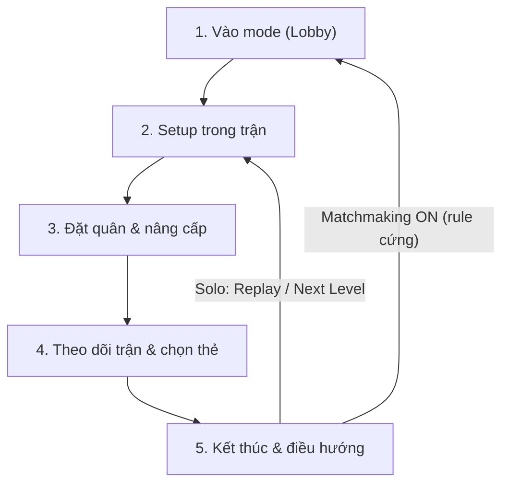

# ARCHITECTURE — AA mango

Tài liệu kiến trúc cho người đọc và cho agent khi task là về luồng tổng thể.
Luật làm việc nằm ở `AGENTS.md`. Bằng chứng gần nhất nằm ở 60 dòng cuối `context.md`.

---

## 1. Dự án

Macro AutoHotkey v2 tự động hoá Anime Adventures trên Roblox:
vào mode → ghép trận/solo → căn camera → đặt unit → nâng cấp → theo dõi trận → chọn thẻ → xử lý kết thúc → lặp lại.

Công nghệ:

- `FindText`: nhận diện mẫu pixel/ảnh/chữ nhị phân.
- `Windows.Media.Ocr` (`Lib\OCR-main`): đọc tên map, CAPTCHA, nội dung thẻ, cấp nâng cấp.
- `GDI+` (`Lib\AHKv2-Gdip-master`): chụp client Roblox từ bộ nhớ.
- Input: `SendMode "Event"`, `FixClick` (move → nudge 1px → click), `FixMove` (move → nudge trước wheel).
- Discord webhook: báo thắng/thua kèm ảnh.

---

## 2. Phân vùng

| Vùng | Đường dẫn | Vai trò |
|---|---|---|
| PROD | `D:\Macro\AA mango` | Code đang chạy. Sửa theo `AGENTS.md`. |
| DEV | `D:\Macro\AA-mango-dev` | Test, probe, đo toạ độ, backup, archive. |
| Docs | `D:\Macro` | `AGENTS.md`, `context.md`, `ARCHITECTURE.md`. |

### File chính trong PROD

| File | Vai trò |
|---|---|
| `Main.ahk` | Entry point, hotkey, hook `--run <Fn>` để chạy một hàm. |
| `Lib\GameMango.ahk` | Logic game: vào mode, setup, đặt/nâng cấp unit, theo dõi trận, thẻ bài, kết thúc. |
| `Lib\Functions.ahk` | Input helper, settings, CAPTCHA, chat, leaderboard, cấu hình. |
| `Lib\GUI.ahk` | GUI, dropdown mode/map, checkbox, hotkey, `ProcessLog`. |
| `Lib\Image.ahk` | Chuỗi `FindText` cho nút/chữ/icon. |
| `Lib\webhooksettings.ahk` | Cấu hình và gửi Discord webhook. |
| `Settings\Configuration.txt` | Cấu hình người dùng (không commit). |

---

## 3. Mode hiện có

`Infinite, Story, Portal, Daily Infinite Quest, Farm, Legend, Raid, Infinity Castle, Dungeon, Summer Event`.

`StartSelectedMode()` dispatch từng mode. `Contract` đã được user bỏ có chủ đích (2026-11-04).

---

## 4. Vòng đời 5 giai đoạn

### 1. Vào mode — `StartSelectedMode`

- Đi route của mode tới khu chọn màn.
- `Matchmaking` bật → `FindMatch()`: OCR CAPTCHA, nhập, xác nhận, chờ phòng.
- `Matchmaking` tắt → `PlayHere()`: vào solo.

### 2. Setup — `RestartStage` → `BasicSetup`

- `CheckLoaded`: nhận diện lobby/loading/trong trận.
- Đóng leaderboard, đóng chat.
- `TpSpawn`: teleport về spawn, xử lý settings.
- `PlacementCamera`: zoom/pitch theo góc đặt quân.
- `HandleMapMovement(map)`: route riêng từng map (Summer bỏ qua, đứng tại spawn).
- `StartedGame`: bỏ phiếu bắt đầu.

### 3. Đặt quân — `PlacingUnits`

- Chọn slot bằng phím `1`–`6` (không click hotbar).
- Toạ độ từ file cấu hình hoặc `GenerateCirclePoints` (64 điểm).
- `UnitPlaced` xác nhận trước khi tính là đã đặt.
- `UpgradeUnits` / `UpgradeUnit` mở panel và nâng cấp theo priority/MaxLevel.

### 4. Theo dõi — `MonitorStage`

- Anti-AFK định kỳ.
- `WaitForCardChoice` / `ChooseCard`: OCR thẻ, chọn theo blueprint.
- Auto Ability nếu bật.

### 5. Kết thúc — `MonitorEndScreen`

- `ResultScreenReady` / `ClassifyResultScreen` xác nhận cụm UI kết quả.
- Matchmaking ON → `Return to lobby` → `StartSelectedMode`.
- Solo → `Replay` / `Next Level` / `Return to lobby` theo checkbox.
- Hết vé Raid/thiếu key → game trả về lobby → `CheckLoaded` nhận `AreaText` và vào lại mode.

---

## 5. Summer Event (trạng thái hiện tại)

- Click `Play` ở lobby → teleport vào khu Summer.
- `SummerApproachQueue`: giữ `W` tới khi bảng `Join Matchmaking` mở (tối đa 5s).
- Bấm Find Match/Play Here theo `MatchMaking`.
- Nếu CAPTCHA xuất hiện: `SummerHandleVerification` gọi `CaptchaDetect` (vùng chữ xanh), nhập mã, chờ hộp đóng; fallback chờ user nếu OCR không chắc.
- Không `DetectSummerMap`; vào trận gọi `RestartStage("Summer Event")`, bỏ qua `HandleMapMovement`, đặt quân quanh spawn.

Phần này chưa được xác nhận toàn luồng live — xem `context.md`.

---

## 6. Dev harness

- `AA-mango-dev\Harness\Snapshot.ahk --auto` → ảnh client + `Debug\latest.json`.
- `AA-mango-dev\Harness\TestState.ahk <State>` → chạy một state.
- `Main.ahk --run <Fn> <out.json> <ms>` → chạy một hàm.
- `AA-mango-dev\check-invariants.ps1` → validate + kiểm tra bất biến.
- `AA-mango-dev\Tests\` → test offline.

`ok=true` chỉ là không exception. Kết quả thật đọc từ log/ảnh.
